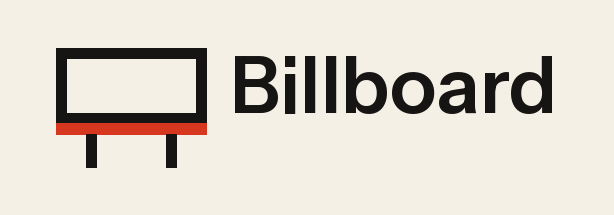

<p align="center">
  
</p>


<p align="center">
<a href="https://packagist.org/packages/usamamuneerchaudhary/billboard"></a>
  <a href="https://packagist.org/packages/usamamuneerchaudhary/billboard"></a>
</p>

Ad management for Statamic 6. Create placements for the slots in your templates, add image, text or ad network ads to them, and let Billboard handle rotation, scheduling, targeting and reporting.

- **Placements** with weighted or ordered rotation, several ads at once, reserved sizes and a fallback.
- **Image, text and HTML ads.** HTML ads accept ad network tags such as Google Ad Manager or AdSense.
- **Scheduling** with start and end dates and times.
- **Targeting** by page path, device and site, with total impression and click limits and an optional daily limit per visitor.
- **Works with full static caching.** Placements can choose ads in the browser, so rotation and schedules keep working on cached pages.
- **First-party reporting.** Viewable impressions, clicks and click-through rate by day and by ad, with CSV export and a dashboard widget. Nothing is sent to third parties.
- **Native control panel screens** built on Statamic's own publish forms, listings, actions and permissions.

## Contents

- [Requirements](#requirements)
- [Installation](#installation)
- [Quick start](#quick-start)
- [Templates](#templates)
- [Choosing ads on the server or in the browser](#choosing-ads-on-the-server-or-in-the-browser)
- [Targeting and limits](#targeting-and-limits)
- [Reporting and privacy](#reporting-and-privacy)
- [Permissions](#permissions)
- [Dashboard widget](#dashboard-widget)
- [Customising the output](#customising-the-output)
- [Configuration](#configuration)
- [Events](#events)
- [Commands](#commands)
- [Security notes](#security-notes)
- [Developing](#developing)
- [Support](#support)

## Requirements

- Statamic 6
- PHP 8.2 or later
- A database connection for reporting. SQLite, MySQL, MariaDB and PostgreSQL are supported. Ads display without one; only reporting and impression and click limits need it.

## Installation

```bash
composer require usamamuneerchaudhary/billboard
php artisan migrate
```

Statamic publishes Billboard's control panel and front-end assets automatically when the package is installed. If you deploy with a build step that skips this, publish them yourself:

```bash
php artisan vendor:publish --tag=billboard --force
```

The migration creates one table, `billboard_stats`. To change the table name or connection, publish the config first (see [Configuration](#configuration)).

## Quick start

1. In the control panel, go to **Advertising → Placements** and create a placement, for example **Sidebar**.
2. Add its tag to a template:

   ```antlers
   {{ billboard:sidebar }}
   ```

3. Go to **Advertising → Ads**, create an ad, and choose **Sidebar** under **Placement & schedule**.

That's it. The first placement on each page also outputs Billboard's small script and stylesheet.

## Templates

### Antlers

```antlers
{{# By handle #}}
{{ billboard:sidebar }}
{{ billboard:placement handle="sidebar" }}

{{# From a field (see "Letting editors choose a placement" below) #}}
{{ billboard:placement :handle="ad_slot" }}

{{# One specific ad, outside any placement #}}
{{ billboard:ad id="0f8c6d0e-…" }}

{{# The script and stylesheet, if you turned off auto_assets #}}
{{ billboard:assets }}
```

A placement that doesn't exist, or has nothing to show and no fallback, outputs nothing, so a template never breaks.

### Blade

```blade
@billboard('sidebar')

<s:billboard:placement handle="sidebar" />

@billboardAssets
```

### Custom markup with a tag pair

Use the tag as a pair to write your own markup. Ads are chosen on the server in this mode.

```antlers
{{ billboard:placement handle="sidebar" }}
    <div class="my-ads" {{ placement_attributes }}>
        <p class="my-ads__label">{{ label }}</p>
        {{ ads }}
            <a href="{{ url }}" rel="{{ rel }}" {{ if target }}target="_blank"{{ /if }} {{ attributes }}>
                {{ if type == 'image' }}
                    
                {{ elseif type == 'text' }}
                    <strong>{{ headline | entities }}</strong>
                {{ /if }}
            </a>
        {{ /ads }}
    </div>
{{ /billboard:placement }}
```

Keep `{{ placement_attributes }}` on the wrapper and `{{ attributes }}` on each ad. The script uses them for impression counting and device targeting.

These variables are available:

- **In the placement:** `handle`, `title`, `label`, `width`, `height`, `fallback` and `total_results`.
- **For each ad:** `id`, `title`, `type`, `url` (the tracked click link), `destination`, `rel`, `target`, `image:src`, `image:alt`, `image:width`, `image:height`, `headline`, `body`, `button_text`, `html` and `attributes`.

Antlers doesn't escape output, so use `| entities` on text your editors enter.

### Inside a page, post, or other entry

Template tags are for fixed slots, such as a sidebar in the layout. To place an ad in the body of an entry, editors do it from the publish form. The content renders the ad; they do not paste PHP or a Blade directive into the entry.

**Markdown content.** On a Markdown field, open the field menu and choose **Insert advertisement**, then pick a placement. That inserts `{{ billboard:test }}` (or `[billboard:test]`) into the content. `{{ content }}` renders it with the rest of the page. The same shortcode is left as text in the control panel, so listings do not load a live ad.

**Bard and Replicator.** Set `content.inject_sets` to `true` in the `billboard` config to add an **Advertisement** set to every Bard and Replicator field on entries, terms, and globals. Editors insert that set and pick a placement. In the template, output the set with the rest of the content:

```antlers
{{ content }}
    {{ if type == "text" }}
        {{ text }}
    {{ elseif type == "advertisement" }}
        {{ placement }}
    {{ /if }}
{{ /content }}
```

`{{ placement }}` is the rendered ad. While injection is on, set `billboard: false` on a Bard or Replicator field to keep the set off that field. You can also add the Advertisement set yourself in the blueprint builder when injection is off.

**Its own field.** In the blueprint builder, add the **Advertisement** field wherever a single placement belongs, including inside your own sets. Output the field handle. Antlers prints the ad; Blade needs unescaped output:

```antlers
{{ advertisement }}
```

```blade
{!! $advertisement !!}
```

Do not name that field `billboard`. `{{ billboard }}` is the tag, so a field with the same handle would be hidden by it.

The **Ad placements** dictionary is still available when you want the handle in your own markup:

```antlers
{{ billboard:placement :handle="ad_slot" }}
```

## Choosing ads on the server or in the browser

Each placement has a **Choose ads** setting.

**On the server** (default) picks ads while the page renders and outputs only those ads. Use this when pages aren't statically cached, or when you use half-measure caching or `{{ nocache }}` around the tag.

**In the browser** outputs every eligible ad inside `<template>` elements. The script picks which to show using each ad's weight, start and end time, device and daily visitor limit. Choose this if your site uses full static caching; otherwise every visitor of a cached page would see the same ad, and a finished campaign would keep showing until the cache clears.

Two settings help keep cached pages fresh:

- Ads scheduled to start later are included in browser placements, so they appear on time without clearing the cache.
- **Clear the static cache when ads change** (in the add-on settings) clears the static cache whenever an ad or placement is saved or deleted.

Visitors without JavaScript see nothing in browser placements. Server placements render normally without JavaScript, but won't count impressions.

## Targeting and limits

You'll find these on each ad under **Targeting & limits**.

- **Only on these paths / Never on these paths:** use `*` as a wildcard. `/blog/*` matches `/blog` and everything under it. Exclusions win over inclusions.
- **Devices:** mobile means a viewport narrower than `frontend.mobile_breakpoint` (768px by default). It's checked in the browser, so it works in both delivery modes. If every ad in a placement is hidden this way, the fallback is shown.
- **Sites:** only appears when you have more than one site.
- **Maximum impressions / maximum clicks:** stop showing an ad once it reaches the total. These need reporting to be set up. Totals are cached for 60 seconds, so an ad can go slightly over its limit on a busy site.
- **Views per visitor per day:** only applies in browser placements. It keeps a small counter in the visitor's `localStorage`, as described below.

## Reporting and privacy

**What is recorded:** one row per ad, placement and day, holding an impression count and a click count. There are no IP addresses, cookies, user agents, visitor IDs or page URLs.

**What counts:**

- **Impressions:** an impression is counted once at least half the ad has been on screen for one second. This follows the common industry definition of a viewable impression, so an ad at the bottom of a page nobody scrolls to isn't counted. Impressions are sent to your own site in small batches.
- **Clicks:** clicks go through `/!/billboard/click/{ad}/{placement}`, which counts the click and redirects to the ad's destination. Clicks on HTML ads are only counted where you use the `%%CLICK_URL%%` macro.

**What doesn't count:**

- Known bots, crawlers, link previewers and headless browsers. Add your own patterns in `tracking.bot_patterns`.
- Visitors sending **Global Privacy Control** or **Do Not Track**, while **Respect privacy signals** is on (the default).
- Anything at all, while **Count impressions and clicks** is switched off in settings. Ads keep displaying.

**Data kept in the browser:** only for ads with a daily visitor limit, a per-ad counter is stored in `localStorage` under `billboard:seen:{ad id}`. It never leaves the browser. Depending on where your visitors are, storing it may require consent. If that's a concern, don't use daily visitor limits.

**Rate limiting:** tracking requests are limited per visitor (`tracking.rate_limit`, 120 per minute). The limiter keys on the visitor's IP in your cache for up to a minute, which is the same mechanism Laravel uses for login throttling. IPs are never written to the database.

**Retention:** daily totals older than **Keep statistics for** (395 days by default) are deleted by the `billboard:prune-stats` command. The command is scheduled daily, so make sure your server runs Laravel's scheduler.

You'll find reports under **Advertising → Reports**. You can filter by period, placement and ad, compare with the previous period, and export CSV.

## Permissions

Billboard adds an **Advertising** group to roles:

| Permission | Allows |
| --- | --- |
| View ads | Seeing the ads listing |
| Edit ads | Changing ads, and enabling or disabling them |
| Create ads | Creating ads |
| Delete ads | Deleting ads |
| Edit HTML ads | Creating or changing HTML ads. Grant this only to people you trust with site code. Others see HTML ads read-only. |
| Manage placements | Creating, editing and deleting placements, including fallback HTML |
| View ad reports | The reports page, CSV export and dashboard widget |

Every control panel route and action checks these on the server.

## Dashboard widget

Add it to `config/statamic/cp.php`:

```php
'widgets' => [
    ['type' => 'billboard_performance', 'width' => 50, 'days' => 30, 'limit' => 5],
],
```

The widget only appears for users who can view ad reports.

## Customising the output

**Styles.** The default stylesheet uses `:where()`, so any rule of yours wins. Adjust it with custom properties:

```css
.billboard {
    --billboard-label-color: #4b5563;
    --billboard-border-color: #e5e7eb;
    --billboard-radius: 12px;
    --billboard-accent: #0f766e;
    --billboard-accent-text: #fff;
}
```

To style everything yourself, turn off **Include default styles** in the add-on settings.

**Markup.** Publish the views:

```bash
php artisan vendor:publish --tag=billboard-views
```

This copies `placement.blade.php`, `ad.blade.php` and `assets.blade.php` to `resources/views/vendor/billboard`. Keep the `data-billboard-*` attributes.

**Scripts loaded later.** If placements are added to the page after load, for example by Livewire or a JavaScript router, call:

```js
window.Billboard.scan();
```

## Configuration

Editors manage day-to-day options under **Tools → Addons → Billboard → Settings**: reporting, privacy signals, retention, label, default styles and static cache clearing.

Developer options live in the config file:

```bash
php artisan vendor:publish --tag=billboard-config
```

| Key | Default | Description |
| --- | --- | --- |
| `storage.ads` | `content/billboard/ads` | Folder for ad YAML files |
| `storage.placements` | `content/billboard/placements` | Folder for placement YAML files |
| `assets.container` | first container | Asset container for image ads (`BILLBOARD_ASSET_CONTAINER`) |
| `assets.folder` | `billboard` | Upload folder within the container |
| `tracking.connection` | default | Database connection (`BILLBOARD_DB_CONNECTION`) |
| `tracking.table` | `billboard_stats` | Stats table name |
| `tracking.rate_limit` | `120` | Tracking requests per minute per visitor |
| `tracking.cap_cache_seconds` | `60` | How long lifetime totals are cached for limits |
| `tracking.bot_patterns` | `[]` | Extra user agent substrings to ignore |
| `frontend.mobile_breakpoint` | `768` | Viewport width below which a visitor counts as mobile |
| `frontend.auto_assets` | `true` | Output the script and stylesheet with the first placement |

Ads and placements are plain YAML files, so commit them with the rest of your content. If your site has no asset containers, image ads use an image URL field instead of the asset picker.

## Events

Listen for these to sync with other systems or clear your own caches:

- `Billboard\Events\AdSaved`
- `Billboard\Events\AdDeleted`
- `Billboard\Events\PlacementSaved`
- `Billboard\Events\PlacementDeleted`

## Commands

```bash
# Delete daily totals older than the retention setting (runs daily via the scheduler)
php please billboard:prune-stats

# Or choose the number of days
php please billboard:prune-stats --days=90
```

## Security notes

- **HTML ads and fallback HTML are output as-is.** That's what makes ad network tags work, and it's why they sit behind the **Edit HTML ads** and **Manage placements** permissions. Text and image ads are always escaped.
- **Destination URLs** must be `http://` or `https://` addresses, or paths on your site that start with `/`. `javascript:`, `data:` and protocol-relative URLs are rejected when saving and again when redirecting.
- **The click route isn't an open redirect.** It reads the destination from the saved ad and ignores anything in the query string.
- **The impression route skips CSRF verification.** Statically cached pages carry stale tokens, which would otherwise block counting. The route only increments counters for existing ads in placements they belong to, accepts at most 25 events per request, ignores bots and is rate limited. Statamic's own `nocache` route is handled the same way.
- **Record IDs and handles are validated** before they touch the file system.

## Developing

```bash
composer install
npm install          # needs vendor/statamic/cms from composer install
npm run build        # control panel bundle and front-end script
npm test             # front-end runtime tests (Node 20+)
vendor/bin/phpunit   # PHP tests
```

`npm run dev` starts Vite with hot reloading for the control panel pages.

## Support

- Documentation: this README
- Email: hello@usamamuneer.me

Please include your Statamic, Laravel and PHP versions, and what you expected to happen.
